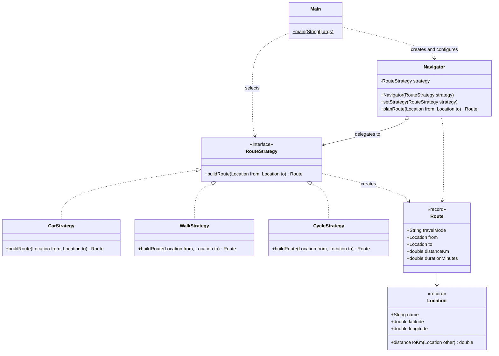

# Assignment #5 - Strategy Pattern

**Topic:** Option A - Navigation / Route Planning

## 1. Introduction

The chosen domain is navigation. Given a start and a destination, a route can be
planned in different ways depending on how the person travels. The algorithm
family is route planning by travel mode: `CarStrategy`, `WalkStrategy` and
`CycleStrategy`. Each one computes distance and travel time with its own
rules (road detour factor and average speed). The `Navigator` (Context) holds
the current strategy and delegates planning to it, and the strategy can be
replaced at runtime.

## 2. UML class diagram



## 3. Clean Code principles applied

### 3.1 Elimination of conditional/branching logic in favor of polymorphism

Before (typical approach):

```java
public Route planRoute(Location from, Location to, String mode) {
    if (mode.equals("car")) {
        ...
    } else if (mode.equals("walk")) {
        ...
    } else if (mode.equals("cycle")) {
        ...
    }
}
```

After:

```java
public Route planRoute(Location from, Location to) {
    return strategy.buildRoute(from, to);
}
```

The choice of algorithm is made by which object is plugged in, not by `if`/`switch`.

### 3.2 Meaningful, intention-revealing names

```java
private static final double ROAD_DETOUR_FACTOR = 1.30;
private static final double AVERAGE_SPEED_KMH = 50.0;
```

Names such as `ROAD_DETOUR_FACTOR`, `AVERAGE_SPEED_KMH`, `distanceToKm` and
`buildRoute` state the meaning and unit, so no comments are needed to explain
magic numbers.

### 3.3 Single Responsibility

```java
public class WalkStrategy implements RouteStrategy {
    @Override
    public Route buildRoute(Location from, Location to) { ... }
}
```

Each strategy has exactly one reason to change: its own algorithm. `Location`
only knows geometry, `Route` only carries results, and `Navigator` only delegates.

### 3.4 Context remains algorithm-agnostic

```java
public class Navigator {
    private RouteStrategy strategy;   // depends only on the interface
    ...
}
```

`Navigator` imports `RouteStrategy`, never `CarStrategy`, `WalkStrategy` or
`CycleStrategy`. It has no knowledge of how routes are computed.

### 3.5 Easy extensibility (Open/Closed)

```java
RouteStrategy scooter = (from, to) -> {
    double distanceKm = from.distanceToKm(to) * 1.15;
    return new Route("E-scooter", from, to, distanceKm, distanceKm / 20.0 * 60);
};
navigator.setStrategy(scooter);
```

A new travel mode is added in `Main` (or as a new class) without editing
`Navigator` or any existing strategy.

### 3.6 Immutability and fail-fast validation

```java
public record Location(String name, double latitude, double longitude) { ... }

this.strategy = Objects.requireNonNull(strategy, "strategy must not be null");
```

`Location` and `Route` are immutable records, and `Navigator` rejects a `null`
strategy immediately instead of failing later with a confusing error.

## 4. Strategy vs. State

Route planning calls for Strategy rather than State because the algorithm is
chosen by the client from outside, based on what the user wants (how they want
to travel), and the strategies are independent of one another and unaware of
each other. In State, the object's own behavior changes as its internal state
changes, and the states usually know about and trigger transitions to other
states. Here, a `CarStrategy` never turns into a `WalkStrategy` by itself; the
client decides when to switch. The strategies are interchangeable ways of doing
the same job, not stages in a life cycle.

## 5. Conclusion

The Strategy pattern gives flexibility: a new travel mode needs one new class
(or a lambda) and no changes to `Navigator`, and strategies can be swapped at
runtime. The cost is a few extra classes (one interface and one class per
algorithm) and the fact that the client has to know which strategies exist.
For a family of algorithms that will grow, this is a good trade, since it
replaces a growing `if`/`switch` chain with small, focused classes.

## 6. GitHub repository

https://github.com/gauharb/sdp-asn5
